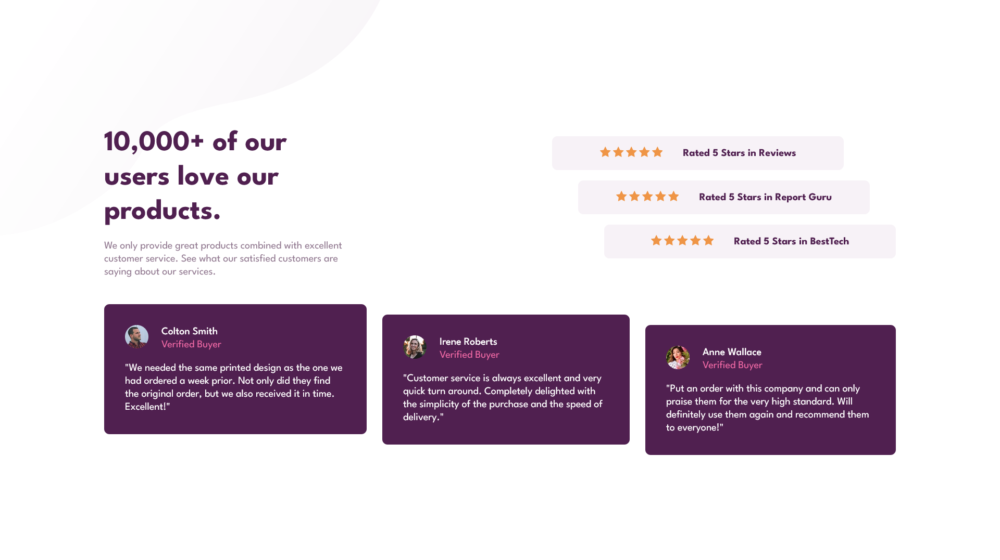

# Frontend Mentor - Social proof section solution

This is my solution to the [Social proof section challenge on Frontend Mentor](https://www.frontendmentor.io/challenges/social-proof-section-6e0qTv_bA).

## 🌐 Language

- [English](./README.md)
- [Português Brasileiro](./README.pt.br.md)

## 📄 Table of contents

- [Frontend Mentor - Social proof section solution](#frontend-mentor---social-proof-section-solution)
  - [🌐 Language](#-language)
  - [📄 Table of contents](#-table-of-contents)
  - [🔍 Overview](#-overview)
    - [💪 The challenge](#-the-challenge)
    - [📷 Screenshot](#-screenshot)
    - [🔗 Links](#-links)
  - [💭 My process](#-my-process)
    - [🛠️ Built with](#️-built-with)
  - [👨🏻‍💻 Author](#-author)

## 🔍 Overview

### 💪 The challenge

Users should be able to:

- View the optimal layout for the section depending on their device's screen size

### 📷 Screenshot

### 🔗 Links

- Solution URL: [Add solution URL here](https://your-solution-url.com)
- Live Site URL: [Add live site URL here](https://your-live-site-url.com)

## 💭 My process

### 🛠️ Built with

- Semantic HTML5 markup
- CSS custom properties
- Flexbox
- Mobile-first workflow

## 👨🏻‍💻 Author

- LinkedIn - [João Martins](https://www.linkedin.com/in/joao-martins-sousa/)
- Frontend Mentor - [@martinsjoaosousa](https://www.frontendmentor.io/profile/martinsjoaosousa)
